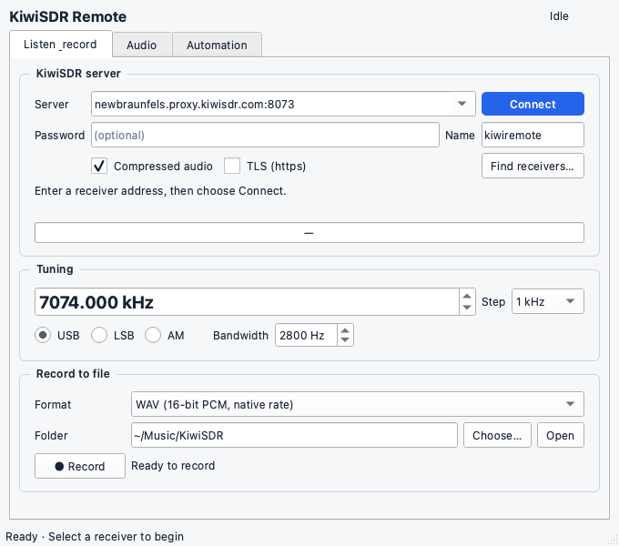
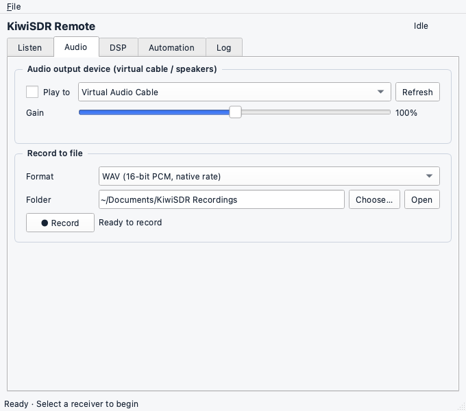
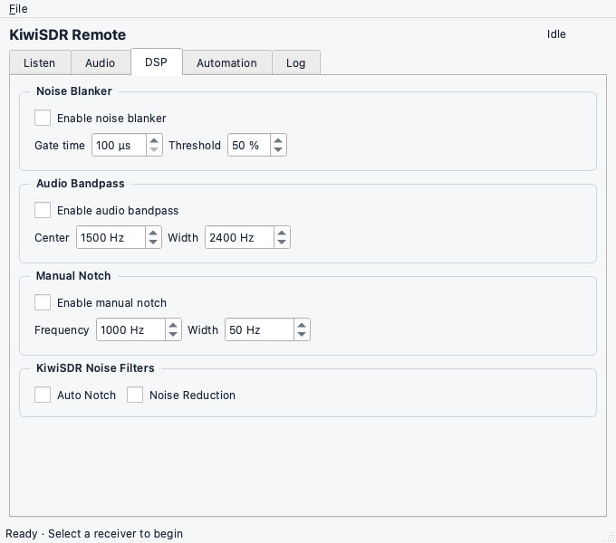
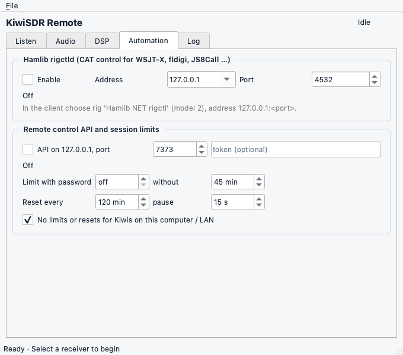

# KiwiSDR Remote Client

A receive-only desktop and headless client for remote KiwiSDR receivers. Tune a
receiver, send its audio to speakers or a virtual cable, and record sessions while
fldigi, WSJT-X or JS8Call handles decoding.

This project builds on [jeffreycentex/kiwisdr-remote](https://github.com/jeffreycentex/kiwisdr-remote)
and uses a pinned copy of [jks-prv/kiwiclient](https://github.com/jks-prv/kiwiclient)
for the receiver protocol. This repository contains the compact interface and the
control, recording and security improvements developed from that codebase.

See the [changelog](CHANGELOG.md) for release details.

## What it does

- **Tune:** USB, LSB, AM, AMN, AMW and FMN, with adjustable bandwidth and receiver-specific frequency limits.
- **Listen:** output to speakers or a virtual audio cable, with drift correction and resampling.
- **Record:** native-rate mono WAV, or AAC in M4A/MP4 when PyAV is installed.
- **Control:** hamlib NET rigctl on `127.0.0.1:4532`, plus an HTTP/JSON API on `127.0.0.1:7373`.
- **Run headless:** connect, tune and record without loading Qt.
- **Decode digital text:** MFSK16, MFSK32, MFSK64, and Contestia 4-250 directly from the receiver audio on the Data tab.
- **Use a compact desktop:** a 680 × 600 light-mode window with Listen, Audio, DSP, Automation, Data, FLAMP and Log tabs. Smaller windows scroll, and window geometry is saved.

The GUI, API and hamlib tuning share one service command queue. Recording has a
separate bounded writer, exclusive file creation, and WAV rotation at 1 GiB.
Existing recordings are never intentionally replaced, including numbered parts.

## Install and run

Requires Python 3.10 or newer. Install dependencies in a virtual environment:

```bash
git clone https://github.com/jeffreycentex/kiwisdr-remote-client.git
cd kiwisdr-remote-client
python -m venv .venv
# macOS / Linux
source .venv/bin/activate
# Windows PowerShell: .venv\Scripts\Activate.ps1
python -m pip install -r requirements.txt
python build_decoder.py
python run_kiwiremote.py
```

Linux also needs PortAudio (`sudo apt install libportaudio2` on Debian/Ubuntu)
and the usual Qt runtime libraries. `samplerate` provides higher-quality
resampling and is skipped on Windows; linear interpolation is the fallback.
PyAV supplies M4A/MP4 recording. WAV works without it. SciPy supplies the local
Audio Bandpass and Manual Notch filters. `certifi` supplements the
system TLS trust store.

Source installations need a C compiler and a C++17 compiler to build the bundled
digital decoder. On macOS use the Xcode command line tools, on Linux use GCC,
and on Windows use MinGW-w64 through MSYS2. For Windows run
`python build_decoder.py --cc gcc --cxx g++` in the UCRT64 environment.
The packaged application includes the decoder.

The Python package and launchers retain their original names (`kiwiremote`,
`run_kiwiremote.py`, and `kiwiremote-cli`) for compatibility. The desktop app is
still named **KiwiSDR Remote**.

## Desktop quick start

1. Enter `host:port`, or `https://host[:port]` for a TLS receiver. Supply a receiver password only if needed, then choose **Connect**.
2. Set frequency in kHz, mode and bandwidth on **Listen**.
3. Choose an output device on **Audio**. For decoding software, select a virtual cable rather than speakers. See [virtual audio setup](docs/VIRTUAL_AUDIO.md).
4. In **Audio → Record to file**, select a format and folder, then choose **Record**. **Open** reveals the output folder.
5. Use **Automation** to configure rigctld, the API and session limits.
6. Use **DSP** to enable the KiwiSDR noise blanker and set its gate time and threshold.
7. Use **Log → Export log…** to save the latest 2,000 lines of the session log as plain text.

### Digital text reception

Tune the receiver on **Listen**, normally in USB, and set a receiver bandwidth
that includes the complete digital signal. On **Data**, select MFSK16, MFSK32,
MFSK64, or Contestia 4-250, enter the signal's audio center in **Sweetspot**, and
choose **Start decoding**. The sweetspot is measured in audio Hz. It does not
change the radio frequency. Use **Stop decoding** before changing the mode or
sweetspot.

**Squelch** starts enabled with a threshold of 20. The **Quality** meter shows
the modem's receive metric from 0 to 100, and **Open/Closed** shows whether that
metric meets the threshold. Adjust the threshold while decoding to suppress
noise characters without restarting the modem.

Choose **Auto (RSID)** to listen for mode announcements and set the modem and
audio center automatically. Auto recognizes MFSK16, MFSK32, MFSK64, and
Contestia 4-250. MFSK64 uses the extended RSID sequence. Auto needs an RSID
announcement in the incoming audio. Select a mode and sweetspot manually for
signals that have no announcement.

To decode a recording, select **Audio file**, choose a file, then start decoding.
Files run through the same squelch and Auto detector as receiver audio and finish
automatically at the end. PCM WAV files work with the minimal dependencies.
PyAV adds formats such as M4A, MP4, FLAC, Ogg, and MP3. File decoding works
without connecting a receiver, and **Stop decoding** cancels processing.

Decoded text appears continuously in the Data pane. **Clear text** clears the
display. Starting reception also works before the receiver connects, and the
decoder resets its modem state when the receiver reconnects.
Mode, sweetspot, and squelch settings are remembered, while decoding starts off.

The decoder receives the Kiwi audio before the local Audio Bandpass and Manual
Notch filters. Receiver-side Auto Notch and Noise Reduction still affect that
audio, so turn them off for data reception.

### FLAMP file reception

The **FLAMP** tab assembles file-transfer frames received through Data from
either receiver audio or a recording. Each row shows the file, received and
total blocks, missing block numbers, and save status. Frames must pass their
CRC checks before their contents are accepted.

Choose a receive folder. **Automatically save completed files** starts enabled.
On macOS the default is `~/Documents/KiwiSDR/Received`. Disable automatic saving
to review completed transfers and use **Save selected**. Existing files are
preserved by creating a numbered filename when necessary.

Incomplete transfers remain in memory while the application is open. Stopping
and restarting Data decoding keeps valid blocks. A later transmission of the
same transfer can fill gaps, and repeated blocks are ignored. Transfers are
tracked separately by their FLAMP identifier. Conflicting metadata or block
contents are reported for review. **Clear selected transfer** resets that
transfer's receive state and leaves any saved file in place.

Plain files, BASE64, BASE128, BASE256, and FLAMP's LZMA compression are supported.
File contents are saved as received. A file's embedded digital signature is
not authenticated by the receiver. Reception is limited to 32 transfers,
32 MiB per file, and 64 MiB of retained transfer data.

The bundled engine uses the GPL fldigi modem implementation and requires no
fldigi installation or virtual audio cable. Its pinned source, licenses and
build provenance are in [third_party/fldigi-core](third_party/fldigi-core/README.md).
THOR is deferred.

### Audio filters

**DSP → Audio Bandpass** uses SciPy to filter playback and recordings.
The cutoff frequencies are center minus and plus half the width. The default
center of 1,500 Hz and width of 2,400 Hz give cutoffs of 300 and 2,700 Hz.
The filter starts off and bypasses settings that put either cutoff outside the
receiver audio's usable range. The cutoff frequencies must be above zero and
below half the incoming sample rate.

**Manual Notch** removes a narrow tone at the chosen audio frequency and width.
It starts off, with a frequency of 1,000 Hz and a width of 50 Hz.
**Auto Notch** and **Noise Reduction** use the KiwiSDR's WDSP filters. Both start
off by default. Leave them off when sending audio to a digital decoder.

### Quick Tune presets

**File → Edit quick-tune presets…** opens `quicktune.txt` in the app's
configuration folder. On macOS, the path is
`~/Library/Preferences/KiwiSDR Remote/quicktune.txt`. Add one
`name, frequency in kHz` entry per line.

```text
# Name, frequency in kHz
40m FT8, 7074
WWV, 10000
```

The app shows up to 15 buttons on **Listen**, with labels limited to 10
characters. A button changes only the frequency. Lines beginning with `#`
are ignored. Save the file to update the buttons while the app is running,
or delete it to hide them.

### Keyboard shortcuts

Keyboard shortcuts use Ctrl on Windows/Linux and Command on macOS:

| Shortcut | Action |
|---|---|
| Ctrl/Command+L | Focus receiver address |
| Ctrl/Command+F | Focus frequency |
| Ctrl/Command+R | Start or stop recording |
| Ctrl/Command+Return | Connect or disconnect |

## Desktop screenshots

### Listen



### Audio



### DSP



### Automation



## Hamlib, API and headless mode

For WSJT-X or JS8Call, choose rig **Hamlib NET rigctl** and network server
`127.0.0.1:4532`. This app is receive-only; PTT commands are accepted and ignored.
For fldigi, enable Hamlib with the same rig and address.

```bash
rigctl -m 2 -r 127.0.0.1:4532 F 7074000
rigctl -m 2 -r 127.0.0.1:4532 M USB 2800

# Start the service in one terminal (API always enabled in headless mode).
python run_kiwiremote.py --headless --record-dir ./recordings

# Control it from another terminal.
python run_kiwiremote.py ctl connect kiwi.example.net:8073 --wait 10
python run_kiwiremote.py ctl tune --khz 7074 --mode USB
python run_kiwiremote.py ctl record-start --name "{date}_net" --max-seconds 3600
python run_kiwiremote.py ctl record-stop
python run_kiwiremote.py ctl disconnect
```

The GUI enables the API on the Automation tab. All interfaces share tuning and
recording state. See [the API reference](docs/API.md) for endpoints, authentication,
error codes, filename templates and resource limits.

## Connections, recordings and security

- Connections retry after 5 seconds, or after 15 seconds when the receiver is busy. A bad password or invalid TLS certificate stops retries.
- TLS verifies certificates. Redirects cannot downgrade TLS to plaintext or forward a password to a different hostname or port. Connect explicitly to the destination if you trust it.
- Both control services default to loopback. The HTTP API requires a token for non-loopback binding, but remains plaintext; rigctld has no authentication. Use an authenticated encrypted tunnel for remote access.
- Browser protections require JSON POST bodies and an allowed Host header; the API does not enable CORS. Request sizes, client counts and WebSocket messages are bounded.
- Recording filenames are reserved atomically. A sample-rate change creates a new part; WAV also rotates at 1 GiB of PCM data. M4A/MP4 uses mono AAC at 48 kHz and 64 kbit/s.
- WAV reconnect gaps are filled with silence, up to 30 minutes per gap. M4A/MP4 does not insert reconnect silence. Storage overload stops recording with an error rather than silently dropping queued audio.
- Receiver passwords are neither saved nor included in application status or authentication logs. An optional API token is stored in Qt settings; protect access to your user account and settings files.

Default session policy: sessions without a password end after 45 minutes;
passworded sessions have no session limit. A periodic reset disconnects for
15 seconds every 120 minutes, retaining a running recording. Local receivers
(loopback, private or link-local connected peer addresses) are exempt. Per-connect
overrides take precedence; zero disables a limit or reset. See the API reference
for exact timer behavior.

## Tests and validation

```bash
python -m pip install numpy
python -m unittest discover -s tests -v
```

The minimal suite uses a fake KiwiSDR and requires no audio hardware. Real Qt GUI
and PyAV recording tests run when those dependencies are installed; otherwise they
are skipped. Qt tests run offscreen with isolated settings. CI runs the suite on
Linux, Windows and macOS with Python 3.10 and 3.13.

Build `python build_decoder.py --test-library` to enable the additional native
known-text checks. They generate signals in memory for all four supported modes,
then decode them using the same helper bundled with the application.

This client has been validated locally on macOS with real Qt and PyAV, a standalone
app build, and live tuning/WAV recording against
`newbraunfels.proxy.kiwisdr.com:8073`. That verifies receiving and recording;
physical audio devices and decoder applications still need testing on each system.

## Build standalone apps

```bash
python -m pip install -r requirements.txt pyinstaller
python build_decoder.py
pyinstaller --noconfirm kiwiremote.spec
```

The pinned kiwiclient sources are included; downloading them again is unnecessary.
Use `python fetch_kiwiclient.py` only when intentionally refreshing that copy.
PyInstaller builds for the current OS; it does not cross-compile.

Windows and Linux builds put two self-contained executables in `dist/` and in
the release archives. **KiwiSDR Remote** opens the GUI, and **kiwiremote-cli**
runs headless mode and API commands. On Windows both filenames end in `.exe`.
On macOS, the GUI is `dist/KiwiSDR Remote.app`. Local macOS builds are
ad-hoc signed and not notarized. GitHub Actions can build Windows x64, macOS Apple
silicon and Linux x64 archives through the **Build** workflow. Publishing a `v*`
tag triggers a release; normal pushes do not create releases.

## Code layout

| Path | Purpose |
|---|---|
| `kiwiremote/gui.py` | Light-mode desktop, settings and queued Qt events |
| `kiwiremote/service.py` | Qt-free session policy and application operations |
| `kiwiremote/commands.py` | Bounded command queue with one owner thread |
| `kiwiremote/radio.py` | Kiwi transport, TLS, redirects, reconnects and audio delivery |
| `kiwiremote/sinks.py` | Playback, buffered recording, file parts and resampling integration |
| `kiwiremote/api.py`, `ctl.py`, `headless.py` | HTTP server, CLI client and headless launcher |
| `kiwiremote/rigctld.py`, `network.py` | Hamlib adapter and bounded control connections |
| `kiwiremote/state.py`, `resample.py` | Tune/server models and streaming resampling |
| `tests/` | Fake receiver and unit/integration tests |
| `AGENTS.md` | Contributor and agent guidance |

## License and attribution

Licensed under **GPL-3.0-or-later**; see [LICENSE](LICENSE). This project retains
history and attribution from [KiwiSDR Remote](https://github.com/jeffreycentex/kiwisdr-remote).
Vendored [kiwiclient](https://github.com/jks-prv/kiwiclient) sources retain their own
licenses: parts are GPL-2.0-or-later and `mod_pywebsocket` is BSD. Keep upstream
copyright and license notices when redistributing source or binaries.
